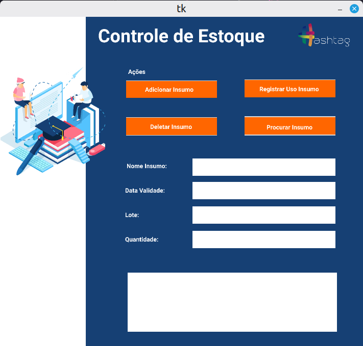
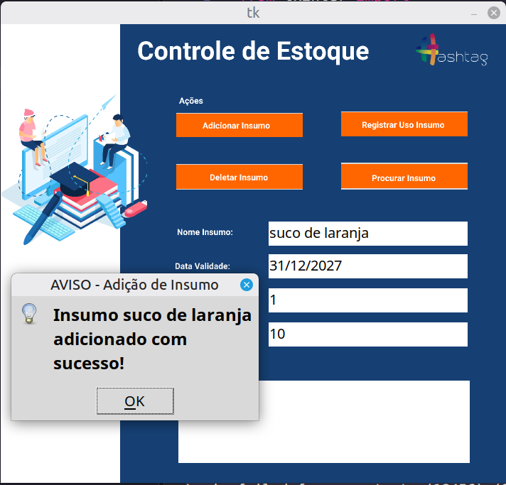
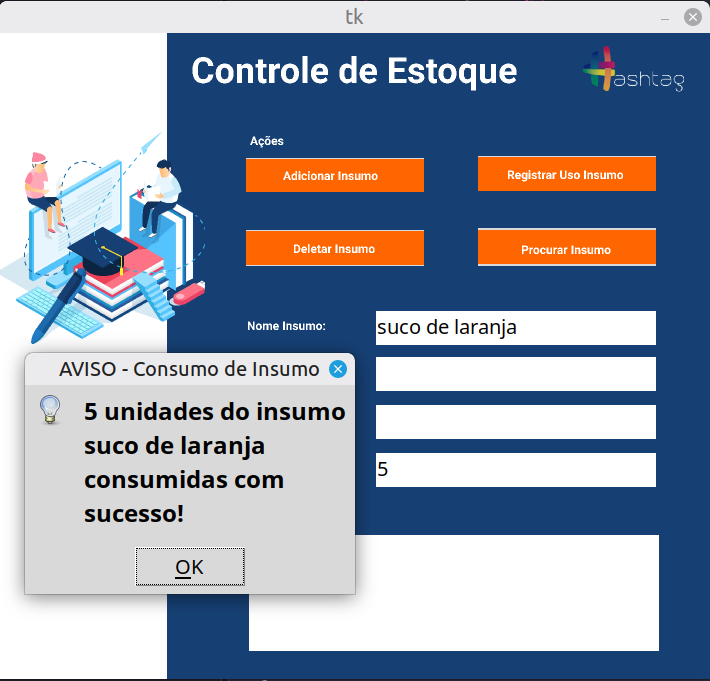
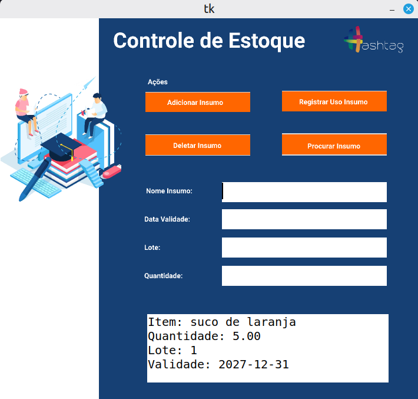

# Programa CRUD - Insumos

Ferramenta de CRUD (banco de dados) para insumos.

---

## Demonstração

| Página Inicial | Adição de Insumo |
| :---: | :---: |
|  |  |

| Consumo de Insumo | Procura de Insumo |
| :---: | :---: |
|  |  |

| Exclusão de Insumo | 
| :---: |
|  |
---

## Tecnologias

Este projeto foi desenvolvido utilizando as seguintes tecnologias:

- **Python 3.12.3**
- **Tkinter (Criação de janelas para programas)**
- **SQL Server e pyodbc (Criação e conexão com banco de dados)**

---

## Funcionalidades

- [x] Adição de insumos no banco de dados
- [x] Consumo de insumos registrados no banco de dados
- [x] Procura de insumos registrados no banco de dados
- [x] Exclusão de insumos do banco de dados

---

## Configuração do Banco de Dados

Como este projeto utiliza o Microsoft SQL Server para gerenciar o estoque, você precisará configurar o banco de dados localmente antes de executar a aplicação:

1. **Crie o Banco de Dados:**
   Abra o seu gerenciador do SQL Server e crie um banco de dados com o nome exato esperado pelo projeto:
   ```sql
   CREATE DATABASE EstoqueMentoria;
   ```

2. **Certifique-se também de criar a tabela Insumos:** 
   - Crie a tabela Insumos com as colunas correspondentes: nome_insumo, qtde, lote e data_validade.

3. **Configure suas credenciais:**
   - No arquivo janela.py, localize a variável dados_conexao nas primeiras linhas do código e substitua os campos UID e PWD com o seu usuário e a sua senha do SQL Server.

   ```python
   dados_conexao = (
       "Driver={ODBC Driver 18 for SQL Server};"
       "Server=localhost;"
       "Database=EstoqueMentoria;"
       "UID=seu_usuario;"       # Insira aqui o seu usuário (ex: sa)
       "PWD=sua_senha_aqui;"    # Insira aqui a sua senha do SQL Server
       "TrustServerCertificate=yes;"
   )
   ```

---

## Como Executar o Projeto

### Pré-requisitos

Antes de começar, você precisará ter instalado em sua máquina:
- [Git](https://git-scm.com)
- [Python 3.12](https://www.python.org/)


### Passo a Passo

1. **Clone este repositório:**
   ```bash
   git clone https://github.com/Brazil25/programa_crud
   ```

2. **Acesse a pasta do projeto:**
   ```bash
   cd programa_crud
   ```

3. **Crie seu banco de dados:**
   - Crie seu banco de dados e a tabela Insumos, conforme orientado anteriormente neste arquivo.

4. **Crie e ative o ambiente virtual (opcional, mas recomendado):**
   ```bash
   python -m venv .venv
   source venv/bin/activate  # Linux/Mac
   # ou: venv\Scripts\activate  # Windows
   ```

5. **Instale as dependências:**
   ```bash
   pip install -r requirements.txt
   ```

6. **Execute a aplicação:**
   ```bash
   python janela.py
   ```


## Licença

Este projeto está sob a licença MIT.
